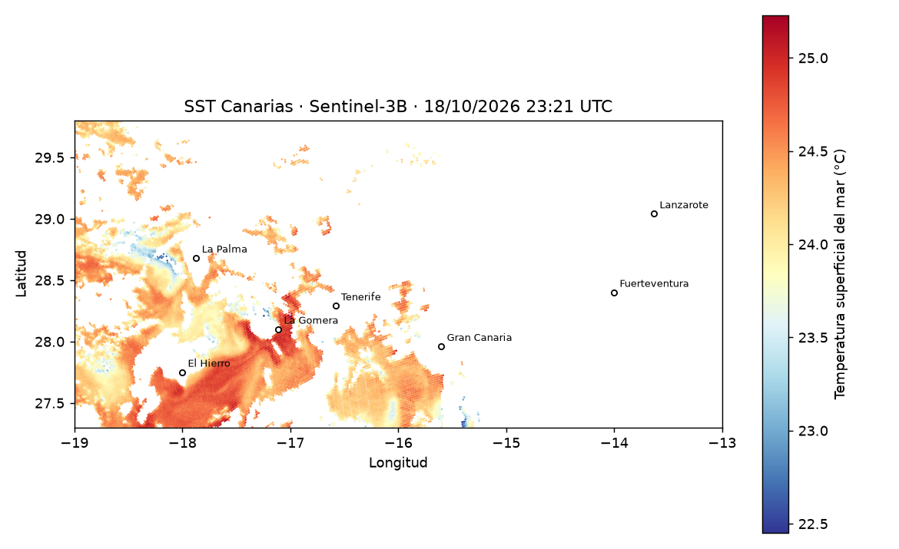

# SST Canarias

Pipeline y API de **temperatura superficial del mar (SST) en Canarias** a partir de datos abiertos
de **Sentinel-3 SLSTR** (Copernicus). Descarga productos nivel 2 (WST), aplica máscara de calidad,
calcula estadísticas, genera un mapa y expone los resultados mediante una API REST en Docker.

Es un proyecto de aprendizaje inspirado en el tipo de trabajo del sector: datos de observación de la
Tierra, formatos científicos (NetCDF), pipelines reproducibles, contenedores y CI.

## Arquitectura

```
Copernicus Data Space (OData)  ->  cdse.py (búsqueda + descarga)
        ->  processing.py (NetCDF, calidad, °C, estadísticas)
        ->  plotting.py (mapa PNG)  +  data/processed/*.json
        ->  api.py (FastAPI)  ->  Docker / GitHub Actions
```

## Requisitos

- Python 3.12+
- Cuenta gratuita en [Copernicus Data Space Ecosystem](https://dataspace.copernicus.eu)

## Puesta en marcha

```bash
python -m venv .venv && source .venv/bin/activate      # en Windows: .venv\Scripts\activate
pip install -r requirements.txt
cp .env.example .env                                    # y rellena tus credenciales
export PYTHONPATH=src                                   # en Windows PowerShell: $env:PYTHONPATH="src"
export CDSE_USERNAME=... CDSE_PASSWORD=...              # o carga el .env con tu herramienta favorita

pytest -q                                               # 22 tests, sin red
python -m sstcanarias.cli search --start 2026-10-10 --end 2026-10-18
python -m sstcanarias.cli run    --start 2026-10-10 --end 2026-10-18 --limit 1
uvicorn sstcanarias.api:app --reload                    # http://localhost:8000/docs
```

Con Docker (sirve lo que haya en `data/processed`):

```bash
docker build -t sst-canarias .
docker run -p 8000:8000 -v "$PWD/data:/data" sst-canarias
```

## Estado de verificación (ejecución real del 19/10/2026)

Probado con datos reales de Copernicus:

- Búsqueda en el catálogo OData por colección, producto `SL_2_WST`, fecha y polígono de Canarias.
- Autenticación, descarga y descompresión de un producto Sentinel-3B.
- Lectura del NetCDF con las variables `sea_surface_temperature`, `quality_level`, `lat` y `lon`.

Resultado sobre la escena del 18/10/2026 (23:21 UTC): 29.334 píxeles válidos, SST media de 24,3 °C
(rango 22,5 a 25,2 °C). Son valores coherentes con la época, pero no se han contrastado con otra fuente.



### Lección aprendida: un producto, varios ficheros

Un producto SLSTR WST contiene varios NetCDF (vistas `NADIR` y `DUAL`) con cobertura distinta. La primera
versión cogía el primero por orden alfabético y devolvía 0 píxeles válidos. Un script de diagnóstico mostró
que el otro fichero sí tenía datos sobre Canarias. Ahora el pipeline procesa todos y se queda con el que más
píxeles válidos tiene en la región (`load_best_sst`), con un test que reproduce el caso.

### Limitaciones conocidas

- Una pasada solo cubre parte del archipiélago: en la escena de ejemplo faltan las islas orientales.
- Las nubes se descartan con el filtro de calidad (`quality_level >= 4`); los bordes de nube pueden dejar
  píxeles fríos aislados.
- Las islas del mapa son puntos de referencia aproximados, no una línea de costa.

## Seguridad

- Las credenciales se leen del entorno y `.env` está en `.gitignore`. Nunca las subas a Git.
- El token solo se reenvía a dominios `*.dataspace.copernicus.eu` por HTTPS (hay test).

## Siguientes pasos posibles

- Serie temporal de varias escenas y comparación por isla.
- Persistencia en PostgreSQL y cola de trabajos.
- Despliegue en AWS (ECR + ECS/EC2) con el mismo contenedor.
